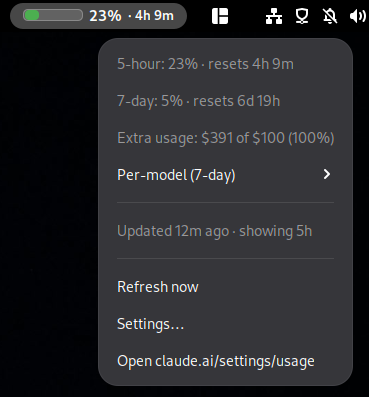

# Claude Usage Panel

A GNOME Shell extension that puts your Claude.ai subscription usage in the
top panel — a colored bar showing the current 5-hour window, plus a
secondary bar that appears when your 7-day usage crosses 50%.

Useful if you use Claude Code (or claude.ai itself) across multiple
machines and want a single, always-on view of where you stand against the
quota — equivalent to <https://claude.ai/settings/usage>, but visible at a
glance.



## Status

This is unofficial. It calls an undocumented endpoint that powers the
claude.ai usage page and is not part of any published Anthropic API. It
can break at any time if the endpoint changes. **Not affiliated with
Anthropic.** Use at your own risk and check claude.ai's terms of service
to make sure automated access fits your use case.

## Requirements

- GNOME Shell 48–51 (tested on Fedora 44, GNOME Shell 50.x; 51 is
  declared but not yet tested)
- `libsoup3` and `libsecret` — both ship with GNOME, no extra installs
  needed on a typical desktop
- A claude.ai account with an active subscription

## Install

### CLI (recommended)

Grab the latest release zip and let `gnome-extensions` install it:

```sh
curl -L -o /tmp/claude-usage@local.zip \
  https://github.com/serversathome-personal/claude-usage-panel/releases/latest/download/claude-usage@local.zip
gnome-extensions install --force /tmp/claude-usage@local.zip
```

Then log out and back in (Wayland has no extension hot-reload), and:

```sh
gnome-extensions enable claude-usage@local
```

### Manual unzip

If you'd rather drop the files in by hand:

```sh
mkdir -p ~/.local/share/gnome-shell/extensions/claude-usage@local
unzip claude-usage@local.zip \
  -d ~/.local/share/gnome-shell/extensions/claude-usage@local
```

Log out, log back in, then `gnome-extensions enable claude-usage@local`.

### From source

```sh
git clone https://github.com/serversathome-personal/claude-usage-panel.git \
  ~/.local/share/gnome-shell/extensions/claude-usage@local
```

Log out, log back in, then `gnome-extensions enable claude-usage@local`.

## First-time setup: cookies

The extension authenticates the same way your browser does: with two
claude.ai cookies stored in your GNOME keyring.

1. Open <https://claude.ai> in a browser and make sure you're logged in.
2. Open devtools (F12 or Ctrl+Shift+I).
3. Go to **Storage → Cookies → https://claude.ai** (Firefox) or
   **Application → Cookies → https://claude.ai** (Chrome/Chromium).
4. Copy the values of:
   - `sessionKey` — long string starting with `sk-ant-sid01-…`
   - `cf_clearance` — Cloudflare token, rotates every few hours/days
5. In the extension's **Settings…** menu (click the panel widget),
   paste both values into the password fields and click **Save & refresh**.

The cookies are stored in your GNOME keyring under
`service=claude-usage`, never written to disk in plaintext.

### Optional: multiple organizations

`sessionKey` and `cf_clearance` are the only required cookies. If your
claude.ai account belongs to more than one organization, the panel
otherwise reports on whichever org the API returns first. To pin it to a
specific org, also copy the optional `lastActiveOrg` cookie (its value is
an organization UUID) and paste it into the separate **lastActiveOrg
(optional)** field in **Settings…**. When that value matches one of your
organizations, the panel reports on that org; otherwise it falls back to
the first one. Leave the field blank if you only have a single
organization.

### When the panel shows `!`

The most common cause is that `cf_clearance` has rotated. Re-paste it via
**Settings…** and the panel will refresh. If you still get HTTP 403 with a
freshly copied `cf_clearance`, Cloudflare probably rejected the user agent:
paste your browser's `navigator.userAgent` (from its devtools console)
into the **Browser user agent** field in **Settings…**. If the error message shown in
the menu mentions HTTP 401 instead, your `sessionKey` has expired —
log into claude.ai in your browser again and re-copy both cookies. An
HTTP 429 means claude.ai is rate limiting the requests; no action is
needed, the panel retries on the next poll.

## What the panel shows

- **Bar (left, wider):** percentage of the rolling 5-hour quota used.
  Color smoothly grades from green to yellow to red as it fills.
- **7-day bar:** overall weekly usage.
- **Per-model bars:** one per separate weekly cap, labelled with the model
  (e.g. `Fable 9% · 6d 4h`).

  Each kind of bar has its own **Auto / Always show / Never show** setting
  in **Settings…**. Auto shows a bar only once it crosses 50%, since most of
  the time it's near zero.
- **Number:** the 5-hour percentage.
- **Countdown:** time until the 5-hour window resets.

Click the widget for more detail, mirroring claude.ai/settings/usage:

- the 5-hour and 7-day windows with reset countdowns
- usage credits (amount used, or why they're off, e.g. "out of credits")
- **Per-model limits**: separate weekly caps such as "Fable this week",
  each with its own reset countdown
- **This week by product**: how this week's usage splits across Claude
  Code, chats, Cowork and so on (shares of your usage, not limits)

If a poll fails, the panel keeps the last good numbers, dimmed and marked
with `!`, and the menu shows the error. After an HTTP 429 the panel backs
off (skipping 1, 2, 4… up to 16 polls) until a request succeeds.

### When the per-model list looks wrong

claude.ai's usage endpoint is undocumented and its keys change with new
models. **Copy raw usage response** in the menu puts the last response
(percentages and timestamps only, no cookies) on your clipboard. Paste it
into an issue so the parser can be updated.

## How it works

A timer in the extension fetches `/api/organizations/{org}/usage` every
60 seconds, parses the JSON, and writes a normalized snapshot to
`~/.cache/claude-usage.json` (the raw response goes to
`~/.cache/claude-usage-raw.json` for debugging). The organization ID is
looked up once and reused until a request fails; with several orgs and no
`lastActiveOrg` set, the one with claude.ai chat access is preferred. The panel reads that cache. Both reads and
writes happen entirely inside `gnome-shell` (no external processes).

## Files

| File             | Purpose                                              |
|------------------|------------------------------------------------------|
| `extension.js`   | Panel indicator, polling timer, menu                 |
| `prefs.js`       | Adwaita settings dialog for cookie entry             |
| `fetcher.js`     | HTTP via libsoup3, secrets via libsecret, cache I/O  |
| `parse.js`       | Pure response parsing (tested with `node --test test/parse.test.mjs`) |
| `stylesheet.css` | Panel bar styling                                    |
| `metadata.json`  | GNOME extension manifest                             |

## Releasing

Bump `version` in `metadata.json`, merge to `main`, then push a tag:

```sh
git tag v0.2.0 && git push origin v0.2.0
```

Or, on GitHub, **Releases → Draft a new release**, type a new tag such as
`v0.2.0` targeting `main`, and publish.

Either way `.github/workflows/release.yml` runs the tests, builds
`claude-usage@local.zip` and attaches it to the release, which is where
the install command above downloads from.

## Acknowledgments

This extension was built collaboratively with [Claude Code](https://claude.com/claude-code),
Anthropic's coding agent — pretty much every commit so far is a pair-programming
session between [@serversathome-personal](https://github.com/serversathome-personal)
and Claude Code. Worth knowing if you're auditing the code or considering
contributions.

### Contributors

- [@serversathome-personal](https://github.com/serversathome-personal) — design,
  direction, testing on Fedora 44 / GNOME 50
- [Claude Code](https://claude.com/claude-code) (Anthropic) — implementation

## License

GPL-2.0-or-later. See [LICENSE](LICENSE).
